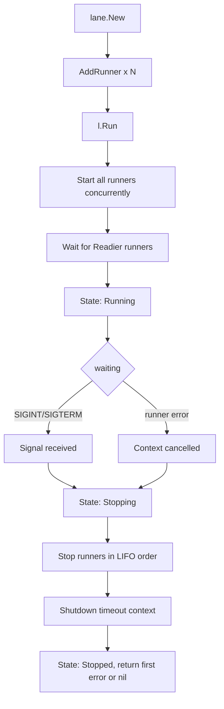

<p align="center">
  
</p>

<p align="center">
  <a href="https://github.com/rluders/lane/actions/workflows/ci.yml">
    
  </a>
  <a href="https://go.dev/doc/devel/release">
    
  </a>
  <a href="https://pkg.go.dev/github.com/rluders/lane/v2">
    
  </a>
  <a href="https://goreportcard.com/report/github.com/rluders/lane">
    
  </a>
  <a href="https://github.com/rluders/lane/releases">
    
  </a>
  <a href="https://codecov.io/gh/rluders/lane">
    
  </a>
  <a href="LICENSE">
    
  </a>
  
</p>

## 🤔 What is lane?

`lane` manages the startup, health, and graceful shutdown of one or more service components — HTTP servers, background workers, schedulers — under a unified context. Register your runners, call `Run`, and lane handles the rest.

## 🎯 Why use it?

Wiring SIGINT/SIGTERM handling, concurrent startup, health probes, and ordered shutdown correctly is tedious boilerplate. `lane` does it once, predictably, so services stay focused on their own logic.

## 🚫 What it does NOT do

- It is not a dependency injection framework
- It does not wire, store, or own your service dependencies
- It does not prescribe configuration, logging format, or database access patterns
- It does not define application structure beyond the `Runner` interface

Dependency wiring is the caller's responsibility.

## 📥 Install

```sh
go get github.com/rluders/lane/v2
```

v2 is in development on `main` and contains breaking changes; v1 remains available as `github.com/rluders/lane@v1`.

## ⚡ Quick Example

```go
package main

import (
    "context"
    "log/slog"
    "net/http"
    "os"
    "time"

    "github.com/rluders/lane/v2"
    "github.com/rluders/lane/v2/runners"
)

func main() {
    lane.RunHealthCheck(":8080")

    log := slog.New(slog.NewTextHandler(os.Stderr, nil))

    mux := http.NewServeMux()

    l := lane.New(lane.WithLogger(log), lane.WithShutdownTimeout(10*time.Second))

    mux.Handle("GET /ready", lane.ReadinessHandler(l.Health()))
    mux.Handle("GET /live", lane.LivenessHandler(l.Health()))

    server := &http.Server{Addr: ":8080", Handler: mux}
    l.AddRunner(runners.NewHTTPRunner("api", server, runners.WithLogger(log)))

    if err := l.Run(context.Background()); err != nil {
        log.Error("lane error", "error", err)
        os.Exit(1)
    }
}
```

## 🔄 Lifecycle



Runners are started concurrently. Shutdown is sequential in **reverse registration order** (LIFO), so dependents stop before the services they depend on.

📖 Full contract: **[docs/lifecycle.md](docs/lifecycle.md)** (states, startup, cancellation vs. failure, shutdown, errors, panics).

## 🧩 Runner Interface

Any component that can start and stop is a Runner:

```go
type Runner interface {
    Name() string
    Start(ctx context.Context) error
    Stop(ctx context.Context) error
}
```

**Contract:**
- `Start` **must block** until the runner stops or fails
- `Stop` initiates graceful shutdown and **must respect the context deadline**
- If `Start` returns a non-nil error, lane cancels all other runners. Once shutdown has begun, returning `ctx.Err()` (`context.Canceled`/`DeadlineExceeded`) from `Start` counts as a clean exit, so `Run` returns `nil` on a normal SIGTERM
- A panic in `Start`, `WaitReady`, or `Stop` is recovered, logged with its stack trace, and treated as an error from that method (`*lane.PanicError`). Goroutines a runner spawns itself are not covered — use `lane.Go`
- Optionally implement `lane.Readier` (`WaitReady(ctx) error`, blocks until ready) to delay lane's readiness until the runner is actually up; `HTTPRunner` does this once its listener is bound
- Every started runner receives `Stop` during shutdown, even if another runner's `Stop` failed or the shutdown timeout expired
- Use `l.AddStage(...)` to start runners in order: a stage starts only after every runner in earlier stages is ready (e.g. DB before API). Shutdown stays reverse-order
- Shutdown is bounded by the shutdown timeout: lane never waits past it for a `Stop` or `Start` that ignores its context. Such runners are reported in the returned error (`context.DeadlineExceeded`) and left running
- `Run` returns the first runner error joined with all `Stop` errors (use `errors.Is` to inspect)

📖 Writing your own runner, patterns and common mistakes: **[docs/runners.md](docs/runners.md)**.

## 📦 Built-in Runners

All implementations live in the `runners/` sub-package.

| Runner | Constructor | Description |
|--------|-------------|-------------|
| HTTP | `runners.NewHTTPRunner(name, server, opts...)` | Wraps `*http.Server`. Calls `Shutdown` on stop. `WithTLS(cert, key)` serves TLS. |
| TCP | `runners.NewTCPRunner(name, addr, handler, opts...)` | Accepts TCP connections, one goroutine per connection. Ready on bind; graceful drain then forced close at the shutdown deadline. `WithTLS` supported. |
| Func | `runners.NewFuncRunner(name, fn, opts...)` | Runs a blocking `func(ctx) error` as a runner; `WithStop(fn)` for cleanup. |
| Worker | `runners.NewWorkerRunner(name, fn, opts...)` | Runs a `runners.Func` in a loop until ctx is cancelled. Backs off exponentially (100ms–30s by default) after errors; tune with `WithBackoff(initial, max)` and `WithBackoffJitter()`. |
| Scheduler | `runners.NewSchedulerRunner(name, interval, fn, opts...)` | Runs a `runners.Func` at a fixed rate, first run after one interval (`WithImmediateRun()` to run at start). Runs never overlap; ticks missed by a slow job are dropped. Errors are logged and scheduling continues. |

All runners share one `runners.Option` type. `WithLogger(log)` (default `slog.Default()`) and `WithErrorHandler(fn)` (worker and scheduler) apply everywhere; options that don't apply to a runner are ignored.

### Worker example

```go
worker := runners.NewWorkerRunner("processor", func(ctx context.Context) error {
    return processNextMessage(ctx)
})
l.AddRunner(worker)
```

### Scheduler example

```go
sched := runners.NewSchedulerRunner("cleanup", 5*time.Minute, func(ctx context.Context) error {
    return purgeExpiredSessions(ctx)
})
l.AddRunner(sched)
```

## 🏥 Health Checks

`l.Health()` exposes the lane's lifecycle state and the liveness and readiness derived from it. The model has no HTTP dependency; the handlers below are thin adapters over it.

| State | When | Live | Ready |
|-------|------|------|-------|
| `Starting` | From `New` until every `Readier` runner is ready | ✅ | ❌ |
| `Running` | Until shutdown begins | ✅ | ✅ |
| `Stopping` | Signal, context cancellation, or runner failure; runners are being stopped. A failure during startup goes here directly, skipping `Running` | ✅ | ❌ |
| `Stopped` | `Run` has returned | ❌ | ❌ |

```go
h := l.Health()
h.State() // lane.StateRunning
h.Live()  // true
h.Ready() // true

mux.Handle("GET /ready", lane.ReadinessHandler(l.Health(), db.PingContext))
mux.Handle("GET /live", lane.LivenessHandler(l.Health()))
```

`ReadinessHandler` returns 200 while the lane is `Running` and all probe functions (`func(ctx context.Context) error`) pass, 503 otherwise. `LivenessHandler` returns 200 until the lane is `Stopped`. Both respond with JSON `{"status": ..., "state": ...}`.

### Container health probe

Call `RunHealthCheck` at the very top of `main()` to support Docker `HEALTHCHECK CMD`-based probes:

```go
func main() {
    lane.RunHealthCheck(":8080")
    // ... rest of main
}
```

When invoked as `myservice healthcheck`, the process sends `GET` to the endpoint and exits 0 (healthy) or 1 (unhealthy, reason on stderr) immediately without starting the service.

| Option | Default | Description |
|--------|---------|-------------|
| `addr` (argument) | — | `":port"` (localhost assumed) or `"host:port"` |
| `WithHealthPath(path)` | `"/live"` | Request path |
| `WithHealthTimeout(d)` | `5s` | Bound on the whole request |
| `WithExpectedStatus(code)` | `200` | Status treated as healthy |

`lane.CheckHealth(ctx, addr, opts...)` performs the same check and returns an error instead of exiting.

## 📡 Observability

Register observers to receive structured lifecycle events (startup, readiness, failures, per-runner stop timings) and feed them to your logger, metrics or tracer. Lane itself depends on none of them.

```go
l := lane.New(lane.WithObserver(func(e lane.Event) {
    if e.Kind == lane.EventRunnerStopped {
        stopSeconds.WithLabelValues(e.Runner).Observe(e.Duration.Seconds())
    }
}))
```

📖 Events, ordering guarantees and slog/Prometheus/OpenTelemetry adapters: **[docs/observability.md](docs/observability.md)**.

## 🛡️ Recovery

### Panic policy

| Where the panic happens | Recovered by | Effect |
|---|---|---|
| `Runner.Start` / `Ready` (incl. `WorkerRunner` and `SchedulerRunner` work functions, which run inside `Start`) | lane | Treated as a runner failure: graceful shutdown, `Run` returns a `*lane.PanicError` |
| `Runner.Stop` | lane | Recorded as a stop error (`*lane.PanicError`); remaining runners still stop |
| Goroutine started with `lane.Go` | `lane.Go` | Logged; the provided `cancel` is called (graceful shutdown if it cancels lane's context). Not in `Run`'s error |
| HTTP handler wrapped in `RecoverMiddleware` | middleware | Logged, HTTP 500; service continues |
| HTTP handler without middleware | `net/http` | Connection closed; service continues |
| Any other goroutine | nobody | Process crashes — wrap critical goroutines in `lane.Go` |

Every recovered panic is logged at error level with the panic value under `panic` and the full stack trace under `stack`. Nothing is restarted.

### Goroutine recovery

`lane.Go` runs a goroutine with structured panic recovery. On panic it logs the stack trace and calls the provided cancel function to propagate the failure up to lane.

```go
lane.Go(ctx, log, "worker-name", cancel, func(ctx context.Context) {
    // critical goroutine — a panic here cancels the application context
})
```

### HTTP handler recovery

`RecoverMiddleware` wraps HTTP handlers with panic recovery. On panic it logs structured context (method, path, stack trace) and returns HTTP 500. The service continues — a single handler panic is recoverable.

```go
handler = lane.RecoverMiddleware(log)(handler)
```

## ⏱️ Shutdown Timeout

Default shutdown timeout is **30 seconds**. Override with `WithShutdownTimeout`:

```go
l := lane.New(lane.WithShutdownTimeout(10*time.Second))
```

Each runner's `Stop` is called with a context that respects this deadline. If a runner does not stop within the timeout, shutdown proceeds without it.

## 🗓️ When to use lane

Use it when you want:

- ✅ Go services with multiple concurrent components (API server + worker + scheduler)
- ✅ Predictable SIGTERM handling and readiness probes in containers
- ✅ Correct lifecycle management without pulling in a full service framework

Avoid it if you need:

- ❌ A dependency injection container
- ❌ A full application framework with routing conventions
- ❌ Managed configuration, observability, or deployment tooling

## 🏗️ Architecture

Two packages, with dependencies pointing one way:

```
lane/v2                    lifecycle core (no dependency on built-in runners)
├── lane.go, runner.go     Lane, Runner, Readier, Run/shutdown coordination
├── health.go              Health + State model (no net/http)
├── healthhttp.go          HTTP adapters: LivenessHandler, ReadinessHandler, CheckHealth, RunHealthCheck
├── recovery.go            PanicError, Go, RecoverMiddleware
└── signals.go             SIGINT/SIGTERM handling

lane/v2/runners            built-in runners: HTTP, Worker, Scheduler
                           (does not import lane; satisfies lane.Runner / lane.Readier structurally)
```

- The core coordinates any `Runner`; it never imports `runners`. Custom runners are first-class.
- The health model (`Health`, `State`) is independent of HTTP; HTTP exposure is a thin adapter in the same package so the common case stays a single import.
- These rules are enforced by `architecture_test.go`.

## ⬆️ Migrating from v1

| v1 | v2 |
|----|----|
| `import "github.com/rluders/lane"` | `import "github.com/rluders/lane/v2"` |
| `lane.New(log, opts...)` | `lane.New(lane.WithLogger(log), opts...)` (logger optional, defaults to `slog.Default()`) |
| `*lane.HealthState`, `SetReady`, `IsReady()` | `*lane.Health` with `State()`, `Live()`, `Ready()`; state is driven by lane only |
| `lane.LivenessHandler()` | `lane.LivenessHandler(l.Health())` (503 once stopped) |
| `RunHealthCheck`/`CheckHealth` default path `/health` | default path `/live` (`WithHealthPath` to override) |
| `Readier.Ready(ctx) error` | `Readier.WaitReady(ctx) error` |
| `runners.NewHTTPRunner(name, srv, log)` | `runners.NewHTTPRunner(name, srv, runners.WithLogger(log))` |
| `runners.NewHTTPSRunner(name, srv, cert, key, log)` | `runners.NewHTTPRunner(name, srv, runners.WithTLS(cert, key))` |
| `runners.NewWorkerRunner(name, fn, log, opts...)` | `runners.NewWorkerRunner(name, fn, opts...)` |
| `runners.NewSchedulerRunner(name, d, fn, log, opts...)` | `runners.NewSchedulerRunner(name, d, fn, opts...)` |
| `runners.WorkFn`, `runners.JobFn` | `runners.Func` |
| `runners.WorkerOption`, `runners.SchedulerOption` | `runners.Option` |
| `runners.WithJobErrorHandler` | `runners.WithErrorHandler` |

## 🧪 Development

CI runs the full test suite with the race detector on every push and pull request. Run the same check locally before opening a PR:

```sh
go test -race ./...
```

## 📄 License

MIT — see [LICENSE](LICENSE).
