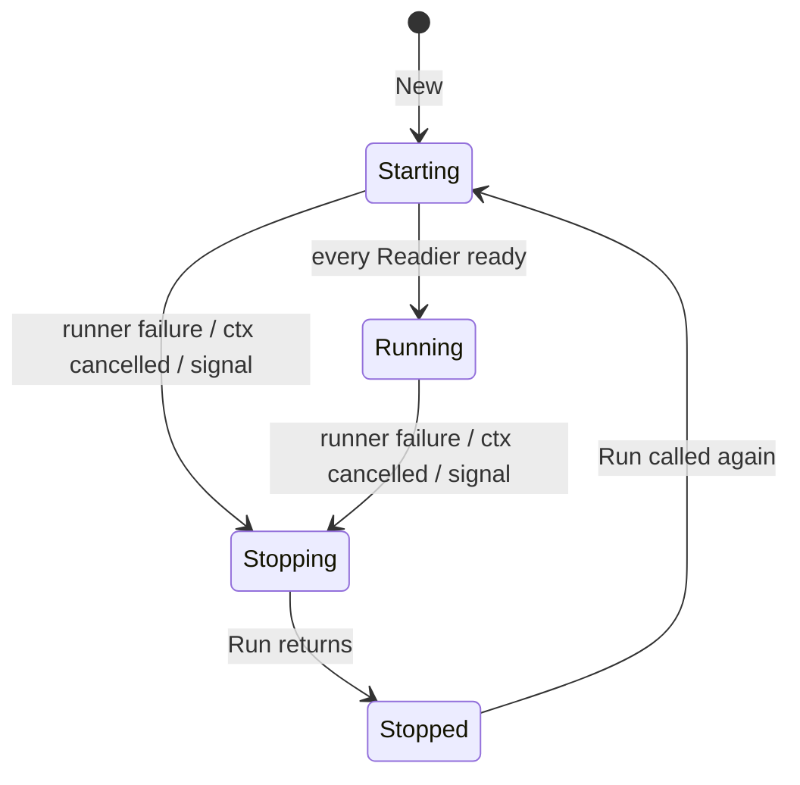

# Lane lifecycle contract

This is the authoritative description of what `lane` guarantees. The godoc on
`Lane.Run`, `Runner` and `Readier` summarizes the same rules; the tests in
`lane_test.go`, `lifecycle_test.go`, `stress_test.go` and
`integration_test.go` verify them.

- [Design principles](#design-principles)
- [Responsibilities](#responsibilities)
- [States](#states)
- [Startup](#startup)
- [Running](#running)
- [Cancellation vs. failure](#cancellation-vs-failure)
- [Shutdown](#shutdown)
- [What `Run` returns](#what-run-returns)
- [Panics](#panics)
- [Repeated and concurrent calls](#repeated-and-concurrent-calls)
- [Lifecycle events](#lifecycle-events)

## Design principles

- **Small core.** Lane coordinates lifecycles: start, readiness, signals,
  ordered shutdown, error reporting. It is not an application framework, DI
  container, scheduler or supervisor.
- **One abstraction.** Everything is a `Runner` (`Name`, `Start`, `Stop`),
  optionally a `Readier`. Built-in runners use no private hooks; custom
  runners are first-class.
- **Context in, error out.** Cancellation flows down through `context.Context`;
  failures flow up as Go errors you inspect with `errors.Is` / `errors.As`.
- **Bounded and predictable.** Shutdown order is fixed, shutdown time is
  bounded, and every behavior below is deterministic except where noted as
  concurrent.
- **No hidden recovery.** Lane never restarts a runner or retries an
  operation. Restart, retry and dependency policies belong to the application.

## Responsibilities

| Concern | Lane | Runner | Application |
|---|---|---|---|
| Calling `Start`/`WaitReady`/`Stop` at the right time | ✅ | | |
| Blocking in `Start` for the component's lifetime | | ✅ | |
| Honouring `ctx` in `Start`, `WaitReady`, `Stop` | | ✅ | |
| Releasing resources the runner acquired | | ✅ | |
| Recovering panics in `Start`/`WaitReady`/`Stop` | ✅ | | |
| Recovering panics in goroutines the runner spawns | | ✅ (`lane.Go`) | |
| SIGINT/SIGTERM handling | ✅ | | |
| Readiness/liveness state | ✅ | signals via `WaitReady` | exposes via HTTP handlers |
| Dependency checks in readiness (DB ping, …) | | | ✅ (`ReadinessHandler` checks) |
| Registration order = shutdown order | ✅ enforces | | ✅ chooses |
| Wiring dependencies, config, retries, restarts | | | ✅ |
| Process exit code | | | ✅ (from `Run`'s error) |

## States

`Lane.Health().State()` reports one of four states. Liveness and readiness are
derived from it.

| State | Meaning | `Live()` | `Ready()` |
|---|---|---|---|
| `Starting` | Created, or `Run` called and not every `Readier` is ready yet | ✅ | ❌ |
| `Running` | All runners launched and every `Readier` ready; no shutdown yet | ✅ | ✅ |
| `Stopping` | Shutdown in progress; runners are being stopped | ✅ | ❌ |
| `Stopped` | `Run` has returned | ❌ | ❌ |

There is no separate `Failed` state: a failure moves Lane to `Stopping` and
then `Stopped`, and the failure is reported through `Run`'s error. Runner
failures never affect liveness. Transitions not shown above are rejected.

## Startup

1. `Run` moves to `Starting` and installs SIGINT/SIGTERM handling.
2. Every runner's `Start` is called **concurrently** in its own goroutine,
   with a context derived from `Run`'s `ctx`. There is no startup ordering.
3. For every runner that implements `Readier`, `WaitReady` is called
   concurrently (it may run before `Start` has begun).
4. When every `WaitReady` has returned nil, Lane moves to `Running`.
   Runners that don't implement `Readier` count as ready once launched; with
   none, Lane is `Running` immediately. In that case startup is effectively
   instantaneous, and a `Start` that fails a moment later is a runtime
   failure (Lane may briefly be `Running`). Implement `Readier` on any runner
   whose initialization can fail if you need "never ready on failed startup".

Startup ends early, going straight to `Stopping` without ever being ready, if:

- any `Start` or `WaitReady` returns an error or panics (**failure**), or
- `ctx` is cancelled or a signal arrives (**cancellation**), including a `ctx`
  that was already cancelled before `Run`.

A `Start` that returns nil during startup just finishes (e.g. a one-shot
migration); it does not block readiness or trigger shutdown.

## Running

Lane waits for the first of: a signal, cancellation of `ctx`, or a runner
failure. A runner whose `Start` returns nil simply finishes; the others keep
running.

## Cancellation vs. failure

| Event | Classification |
|---|---|
| `ctx` cancelled, SIGINT, SIGTERM | intentional shutdown |
| `Start`/`WaitReady` returns a non-nil error while Lane is running | **failure** (includes `context.Canceled`/`DeadlineExceeded` returned spontaneously) |
| `Start` returns `context.Canceled`/`DeadlineExceeded` (wrapped or not) after shutdown began | clean exit |
| `Start` returns any other error after shutdown began | **failure** |
| `Start`/`WaitReady` panics | **failure** (`*PanicError`) |

The first failure is the **primary cause**. It triggers shutdown and is
returned first by `Run`. Later failures, including concurrent ones, are logged
but not returned.

## Shutdown

Shutdown begins on the first signal, `ctx` cancellation, or failure:

1. Lane moves to `Stopping` (not ready, still live) **before** any runner is
   stopped, so load balancers stop sending traffic first.
2. The context passed to every `Start` is cancelled.
3. A shutdown context with the configured timeout (`WithShutdownTimeout`,
   default 30s) is created. It is independent of `Run`'s `ctx`, so cancelling
   that again has no effect on shutdown.
4. `Stop` is called **sequentially in reverse registration order** (LIFO):
   register dependencies first, dependents later, and dependents stop first.
5. Lane waits for every `Start` to return.
6. Lane moves to `Stopped` and `Run` returns.

Guarantees:

- **Every runner receives `Stop` exactly once per `Run`**, including runners
  whose `Start` already returned or failed, whose `Stop` comes after a failing
  `Stop`, and those reached after the deadline.
- A `Stop` error or panic does not stop the sequence.
- **Shutdown is bounded by the timeout.** The deadline is shared by all `Stop`
  calls and the wait for `Start`:
  - A `Stop` still running at the deadline is recorded as
    `stop <name>: context deadline exceeded`, and Lane moves on.
  - Runners reached after the deadline still get `Stop` (with the expired
    context), but Lane doesn't wait for them; their result is only logged.
  - If some `Start` hasn't returned by the deadline, `Run` returns anyway with
    `runners did not exit before shutdown timeout (<names>): context deadline exceeded`.
    Those goroutines are leaked, never killed.

## What `Run` returns

- `nil`: intentional shutdown, no failures, every `Stop` succeeded in time.
- Otherwise `errors.Join` of, in order:
  1. the primary failure (if any),
  2. every `Stop` error/panic, in stop order, each wrapped as `stop <name>: …`,
  3. the shutdown timeout error (if `Start`s were still running).

Inspect with `errors.Is(err, myErr)`, `errors.Is(err, context.DeadlineExceeded)`
and `errors.As(err, &panicErr)`.

## Panics

| Where | Recovered by | Effect |
|---|---|---|
| `Start` / `WaitReady` (incl. built-in worker/scheduler funcs) | Lane | failure → shutdown; `*PanicError{Runner, Op, Value, Stack}` |
| `Stop` | Lane | recorded as that runner's stop error; sequence continues |
| goroutine started with `lane.Go` | `lane.Go` | logged; your `cancel` is called (wire it to `Run`'s ctx for a graceful shutdown) |
| HTTP handler with `RecoverMiddleware` | middleware | logged, 500; service continues |
| any other goroutine | nobody | process crashes |

Every recovered panic is logged at error level with `panic` and the full
`stack`.

## Repeated and concurrent calls

- `Run` may be called again after it returns. State goes `Stopped` → `Starting`,
  and every runner's `Start` and `Stop` are called again, so runners must
  support restarting if you do this.
- `Run` must not be called concurrently on the same `Lane`.
- `AddRunner` must not be called while `Run` is running.

## Lifecycle events

Every transition above is also delivered as an `Event` to observers registered
with `lane.WithObserver`: `LaneStarting`, `RunnerStarting`, `RunnerReady`,
`LaneReady`, `LaneStopping`, `RunnerStopping`, `RunnerStopped`,
`RunnerExited` and `LaneStopped`. Delivery is synchronous and serialized, in
lifecycle order, with nothing after `LaneStopped`. See
[observability.md](observability.md).
